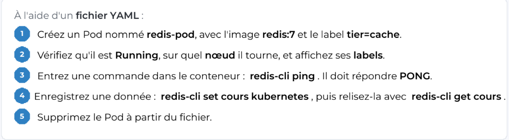
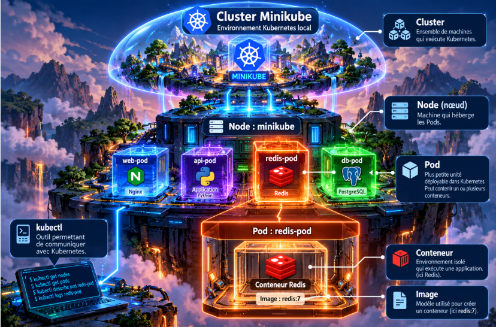
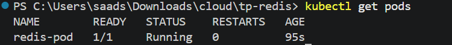
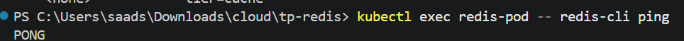
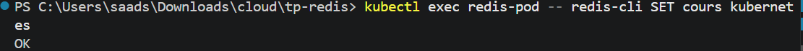
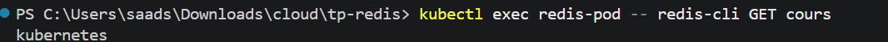
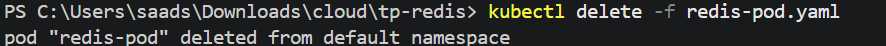

# Kubernetes · Redis Pod

**Déploiement, validation et suppression d'un Pod Redis sur un cluster Minikube local**

Travail pratique réalisé dans le cadre du module *Cloud & IA* — Génie informatique.

## Vue d'ensemble

Ce dépôt documente le cycle de vie d'un Pod Kubernetes exécutant Redis 7, depuis sa déclaration dans un manifeste YAML jusqu'à sa suppression. Le travail porte sur les primitives fondamentales de Kubernetes : définition déclarative, inspection d'une ressource, exécution d'une commande dans un conteneur et vérification du comportement applicatif.

Le périmètre est volontairement limité à **un Pod autonome** : il ne s'agit ni d'un déploiement Redis en production ni d'une infrastructure hautement disponible.

### Périmètre du TP



## Environnement et architecture

| Élément | Configuration utilisée |
| --- | --- |
| Système hôte | Windows 11 |
| Environnement Kubernetes | Minikube, pilote Docker |
| Orchestrateur | Kubernetes v1.37.0 |
| Interface de commande | `kubectl` (client v1.34.1) |
| Application | Redis 7 (`redis:7`) |
| Ressource | Pod `redis-pod` |
| Label | `tier=cache` |
| Port du conteneur | TCP 6379 |
| Espace de noms | `default` |

**Architecture effectivement déployée :** un cluster Minikube à un nœud, contenant le Pod `redis-pod`, lui-même composé d'un conteneur Redis.

La figure ci-dessous sert à situer les concepts de cluster, nœud, Pod, conteneur et image. Elle représente aussi d'autres Pods à titre illustratif, **non créés dans ce TP**.



## Configuration déclarative

Le manifeste [`redis-pod.yaml`](redis-pod.yaml) définit un Pod nommé `redis-pod`, utilisant l'image `redis:7` et portant le label `tier=cache`.

```yaml
apiVersion: v1
kind: Pod
metadata:
  name: redis-pod
  labels:
    tier: cache
spec:
  containers:
    - name: redis
      image: redis:7
      ports:
        - containerPort: 6379
```

`containerPort: 6379` indique le port d'écoute attendu dans le conteneur ; cette déclaration n'expose pas le service à l'extérieur du cluster.

## Exécution et résultats

Les commandes ci-dessous ont été exécutées depuis PowerShell, dans le dossier contenant le manifeste.

### 01 — Création du Pod

```powershell
kubectl apply -f redis-pod.yaml
```

**Résultat constaté :** `pod/redis-pod created`. Le serveur Kubernetes a accepté le manifeste et créé la ressource.


### 02 — Contrôle de l'état, du nœud et des labels

```powershell
kubectl get pods
kubectl get pods -o wide --show-labels
```

Le Pod est **`1/1 Running`**, sans redémarrage. L'affichage détaillé confirme son exécution sur le nœud `minikube`, avec l'adresse IP interne `10.244.0.4` et le label `tier=cache`.




### 03 — Test de disponibilité de Redis

```powershell
kubectl exec redis-pod -- redis-cli ping
```

**Réponse obtenue :** `PONG`. La commande est exécutée dans le conteneur et confirme que le serveur Redis répond au client.



### 04 — Écriture et lecture d'une valeur

```powershell
kubectl exec redis-pod -- redis-cli SET cours kubernetes
kubectl exec redis-pod -- redis-cli GET cours
```

L'instruction `SET` renvoie **`OK`**. La lecture suivante renvoie **`kubernetes`**, ce qui valide l'écriture puis la récupération de la valeur associée à la clé `cours`.





### 05 — Suppression et contrôle final

```powershell
kubectl delete -f redis-pod.yaml
kubectl get pods
```

La suppression du Pod est confirmée par Kubernetes. Le contrôle final renvoie **`No resources found in default namespace.`** : aucun Pod ne subsiste dans cet espace de noms.



## Reproduire le TP

**Prérequis :** un cluster Minikube opérationnel, `kubectl` configuré sur ce cluster et un moteur Docker accessible.

Depuis la racine du dépôt :

```powershell
minikube status
kubectl get nodes
kubectl apply -f redis-pod.yaml
kubectl get pods -o wide --show-labels
kubectl exec redis-pod -- redis-cli ping
kubectl exec redis-pod -- redis-cli SET cours kubernetes
kubectl exec redis-pod -- redis-cli GET cours
kubectl delete -f redis-pod.yaml
kubectl get pods
```

Les captures présentes dans `images/` documentent les résultats observés lors de la réalisation du TP.
